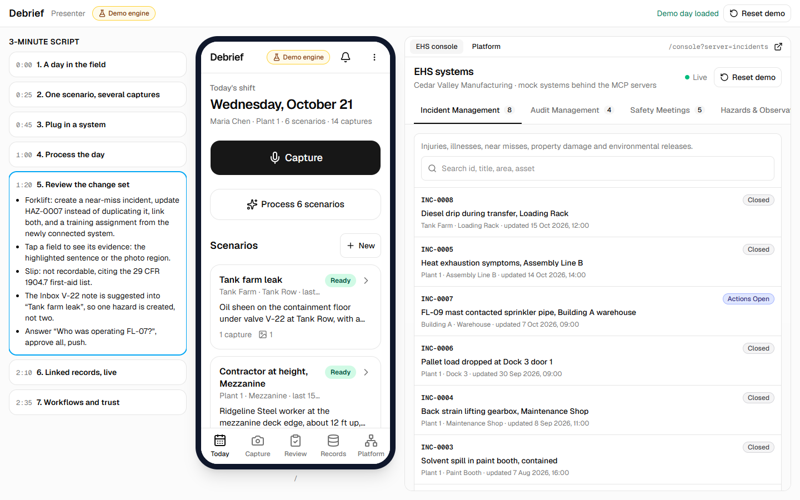
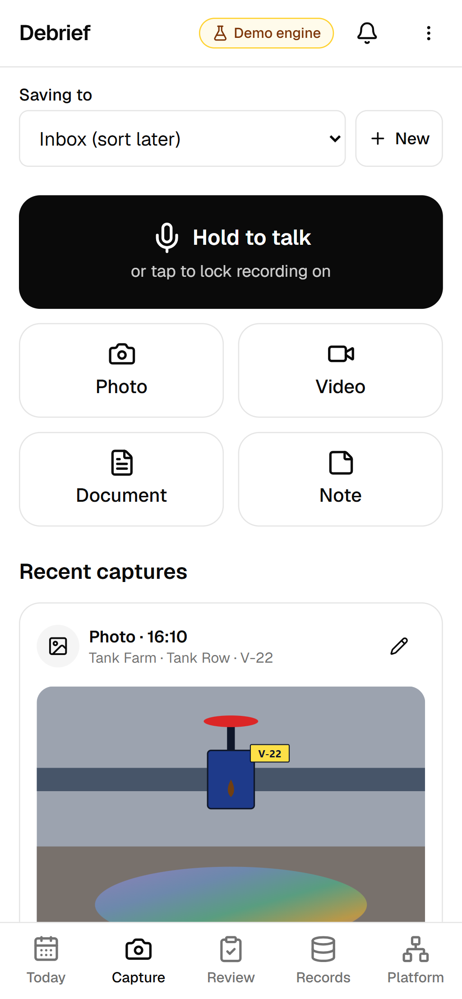
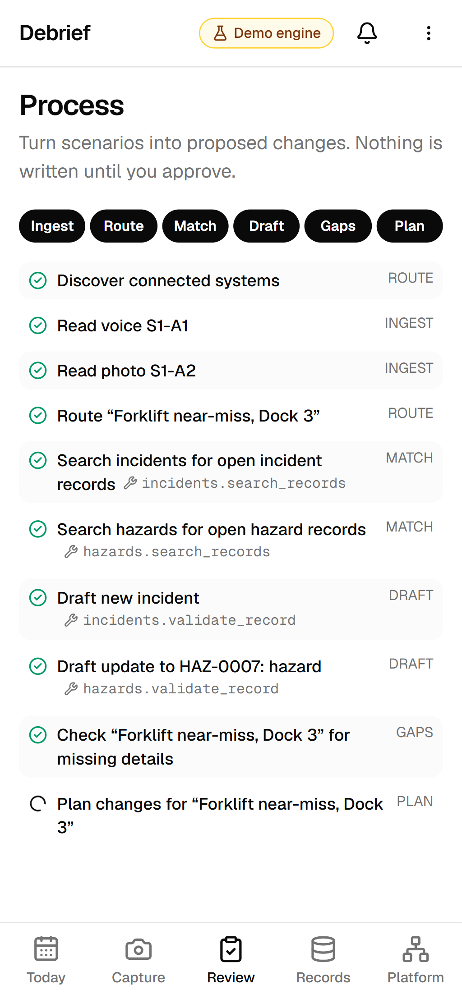
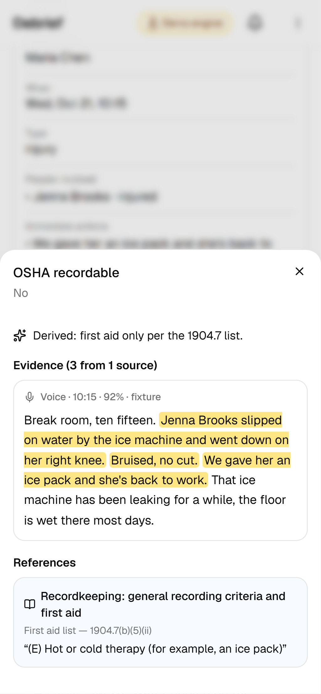
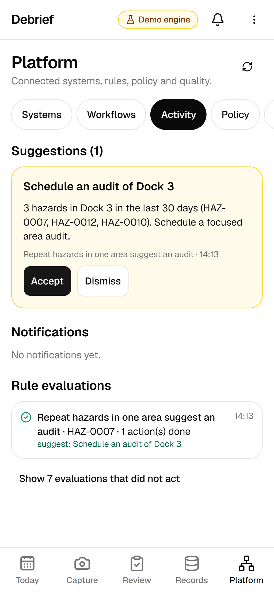

# Debrief

Debrief is a mobile-first web app that turns what a safety professional captures in the field —
voice, photos, video, documents and notes — into the correct, linked records across connected EHS
applications. The agent proposes a change set; the user reviews and approves it before anything is
written.

It runs entirely locally in **demo mode**: perception comes from fixtures, while routing, matching,
drafting, gap-finding, planning, MCP calls and workflows run as real code.



| Capture                                         | Process                                    | Evidence                                          | Workflows                                           |
| ----------------------------------------------- | ------------------------------------------ | ------------------------------------------------- | --------------------------------------------------- |
|  |  |  |  |

## How it works

```
capture (phone, offline) → scenarios → process → review change set → push → linked records + workflows
```

- **Capture app** — a PWA. Voice, photo, video, document and note captures are stored on the
  device (IndexedDB) and grouped into scenarios.
- **Agent pipeline** — perception turns each capture into evidence with provenance; the
  orchestrator routes, matches existing records, drafts from each system's schema, asks for
  missing values and plans an ordered change set. It knows the EHS systems only through their MCP
  manifests and schemas.
- **Gateway** — every write (agent or workflow) is permission-checked, validated, executed with
  an idempotency key, audited and emitted as an event.
- **Mock EHS systems** — Incidents, Audits, Safety Meetings, Hazards & Observations, Checklists &
  Inspections, and Training, each a separate MCP server.
- **Workflow engine** — JSON rules that react to record events.

Details: [Architecture](docs/ARCHITECTURE.md).

## Requirements

- Node.js 20 or newer
- Chrome or Edge (for speech recognition during capture)

## Getting started

```bash
npm install
npm run dev        # http://localhost:3000
```

## Scripts

| Command                   | Purpose                                                             |
| ------------------------- | ------------------------------------------------------------------- |
| `npm run dev`             | Start the app                                                       |
| `npm run build`           | Production build                                                    |
| `npm test`                | Unit tests and data validation (Vitest)                             |
| `npm run test:e2e`        | End-to-end tests in Edge at phone size (Playwright; builds the app) |
| `npm run dev:https`       | HTTPS dev server on the LAN for phone testing                       |
| `npm run demo-assets`     | Regenerate demo illustrations, the checklist PDF and app icons      |
| `npm run typecheck`       | Generate route types and run `tsc --noEmit`                         |
| `npm run lint`            | ESLint                                                              |
| `npm run format`          | Prettier                                                            |
| `npm run seed`            | Rebuild `.data/store.json` from `data/seed` (same as Reset demo)    |
| `npm run mcp -- <server>` | Run one mock EHS server over stdio                                  |
| `npm run eval`            | Score the demo scenarios and variants; writes `evals/results/`      |
| `npm start`               | Serve the production build (after `npm run build`)                  |

## Capture app

The capture app works offline after one online visit: captures are stored on the device
(IndexedDB) and the service worker serves the app shell. Use the menu (⋮) for **Load demo day**
(the six demo scenarios S1–S6) and **Reset demo**.

### Testing on a phone

1. `npm run dev:https`, then open `https://<your-computer-ip>:3000` on the phone (same Wi-Fi) and
   accept the certificate warning. Camera, microphone and live transcripts work.
2. For offline testing the phone must trust the certificate (service workers do not register on a
   certificate error). Either connect an Android phone by USB and forward port 3000 in
   `chrome://inspect`, then open `http://localhost:3000` on the phone; or create a certificate for
   your LAN IP with [mkcert](https://github.com/FiloSottile/mkcert), install its root CA on the
   phone, and run `npx next dev --experimental-https --experimental-https-key key.pem
--experimental-https-cert cert.pem --hostname 0.0.0.0`.

Live transcripts use the browser's speech service and need a connection; offline, the audio is
kept and the transcript can be typed.

## Processing and review

**Process** (Today or the Review tab) sends the chosen scenarios to the demo engine and streams
each step: ingest, route, match, draft, gaps, plan. **Review** groups the proposed actions by
scenario (create, update, link, attach). Tap a field to see the evidence behind it: the
highlighted transcript span, the image region, the document excerpt, or the SOP or regulation
it cites. Answer open questions inline, approve, and **Push**. **Results** shows what was written
and a graph of the linked records; each record opens in the EHS console.

Your own photos, paper forms and PDFs are read on the device (tesseract.js OCR, pdf.js text)
before processing. The OCR and PDF assets are copied into `public/vendor/` by `npm install`.

## Platform

[http://localhost:3000/platform](http://localhost:3000/platform) is the admin view:

- **Systems** — connected MCP servers and their discovered tools. Connect `training` and the next
  forklift incident proposes a training assignment.
- **Workflows** — the JSON rules in `data/workflows/`, what each one did recently, and rules the
  agent proposes from patterns in the records (**Find patterns**).
- **Activity** — notifications and suggestion cards from rules (also behind the header bell).
- **Policy** — autonomy level (auto / approve / blocked) per action type.
- **Audit** — every gateway call by the agent, a workflow or a person.
- **Runs** — run traces of past processing runs on this device.
- **Evals** — the latest eval report, and a button to run it again.

## Mock EHS systems

Five mock EHS applications run as MCP servers — `incidents`, `audits`, `meetings`, `hazards`,
`inspections` — plus `training`, which starts disconnected from the gateway. Their records are
visible at [http://localhost:3000/console](http://localhost:3000/console).

Each server can be reached by any MCP client:

- **Streamable HTTP** (while `npm run dev` is running): `http://localhost:3000/api/mcp/<server>`
- **stdio**: `npm run --silent mcp -- <server>` (or `npx tsx scripts/mcp.ts <server>`). It starts
  from the app's latest state and keeps its writes to itself unless `--persist` is passed.

```bash
# MCP Inspector (UI)
npx @modelcontextprotocol/inspector npx tsx scripts/mcp.ts hazards

# MCP Inspector (CLI) against the running app
npx @modelcontextprotocol/inspector --cli http://localhost:3000/api/mcp/hazards --transport http --method tools/list
```

Claude Desktop (`claude_desktop_config.json`), with `cwd` set to this repository:

```json
{
  "mcpServers": {
    "debrief-hazards": {
      "command": "npx",
      "args": ["tsx", "scripts/mcp.ts", "hazards"],
      "cwd": "/path/to/debrief"
    }
  }
}
```

## Presenter view and demo script

[http://localhost:3000/present](http://localhost:3000/present) (desktop, 1024 px or wider) shows
the demo script, the capture app at phone size and the live EHS console or Platform side by side.
Record links tapped in the phone open in the right-hand pane. The 3-minute walkthrough is in
[docs/DEMO_SCRIPT.md](docs/DEMO_SCRIPT.md).

## Deploying

Debrief keeps the mock EHS systems in memory (snapshotted to `.data/`), so it needs one
long-running Node process; serverless platforms do not keep that state between requests.

- **Render**: `render.yaml` is a blueprint for a Node web service (`npm ci && npm run build`,
  `npm start`, health check `/api/health`). In the Render dashboard choose **New → Blueprint**
  and select this repository. On the free plan the service sleeps when idle and restarts from the
  seed data.
- **Any Node host**: `npm ci && npm run build && npm start`; the server listens on `PORT`
  (default 3000).

Hosting over HTTPS also lets phones use the camera, microphone and speech recognition without the
LAN setup above.

## Documentation

- [Product requirements](docs/PRD.md)
- [Architecture](docs/ARCHITECTURE.md)
- [Decision log](docs/DECISIONS.md)
- [Demo script](docs/DEMO_SCRIPT.md)

## Repository layout

```
data/        seed organization and records, knowledge docs, workflow rules
fixtures/    demo scenarios S1–S6 (artifacts, perception, variants) and expected change sets
src/app/     routes
src/domain/  types and Zod schemas shared by every layer
src/lib/     shared helpers
src/mcp/     mock EHS servers, store and gateway
scripts/     seed and stdio launcher
tests/       data validation, server, gateway and route tests
e2e/         Playwright end-to-end tests
src/capture/ on-device storage (Dexie), capture helpers, device perception, demo day
src/agents/  AgentProvider, DemoProvider, orchestrator (route, match, draft, gaps, plan)
src/rag/     records and knowledge indexes
src/evals/   change-set comparison, scenario harness and eval runner
src/workflows/ workflow engine, feed and rule proposals
evals/       `npm run eval` entry point and results
mcp.config.json  connected servers and their transports
```
