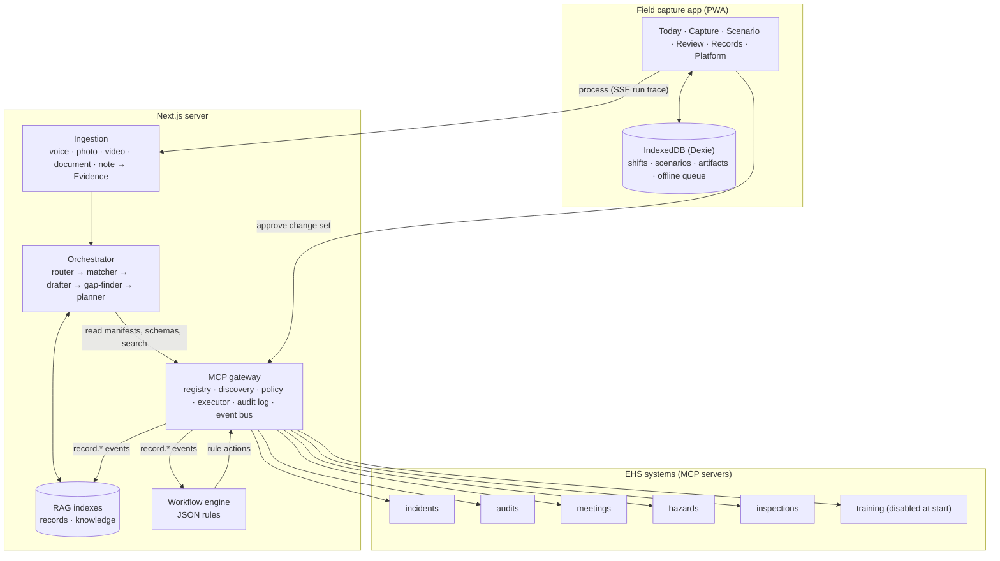
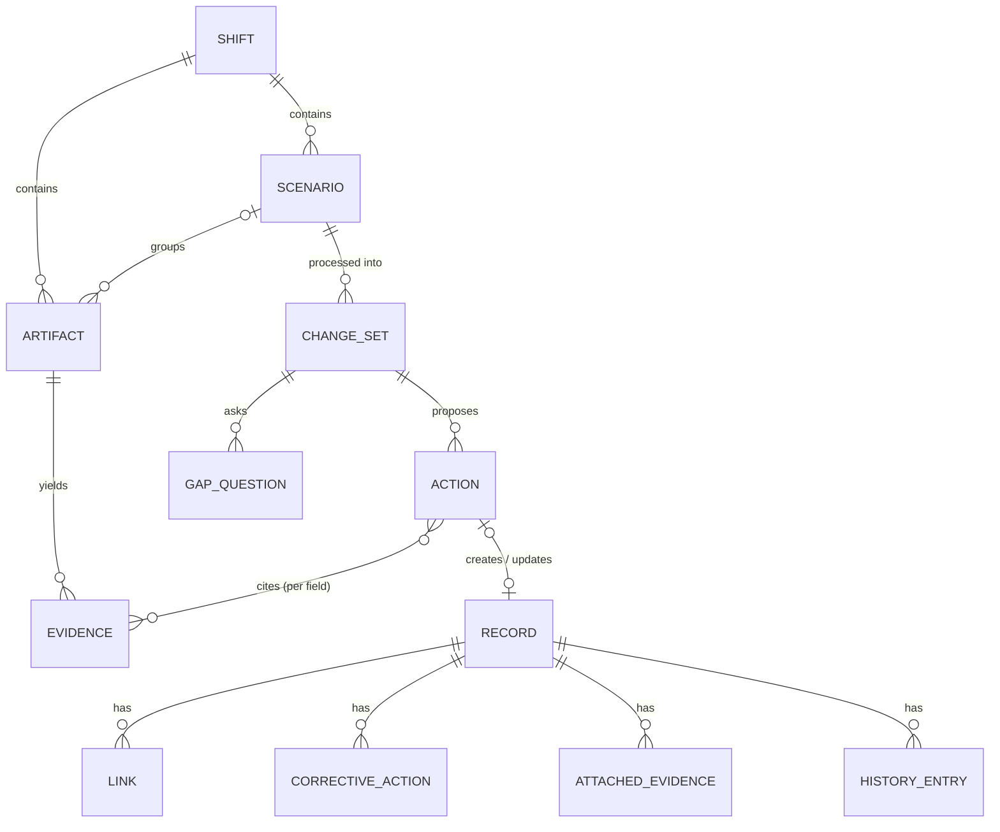
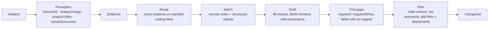
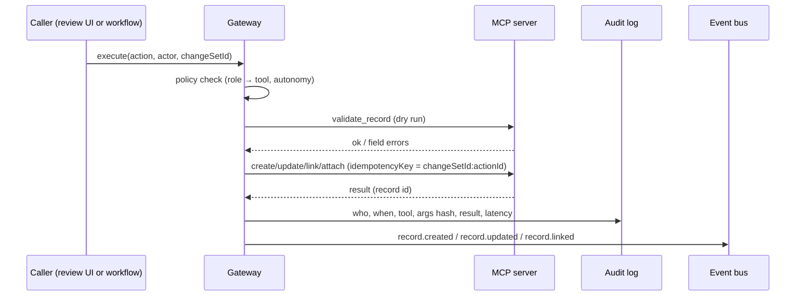
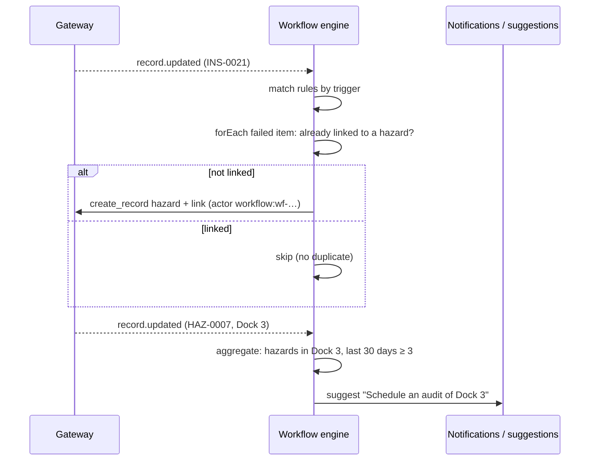
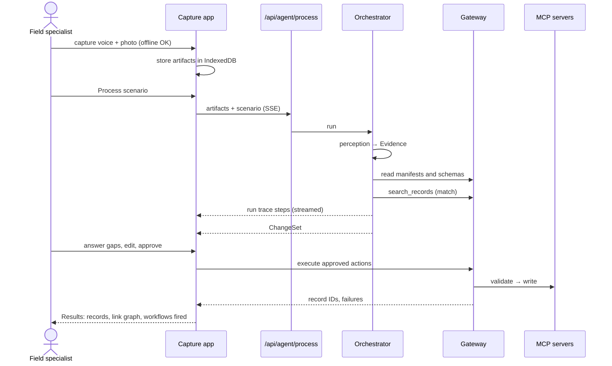

# Debrief — Architecture

## 1. Overview

All AI capabilities sit behind one `AgentProvider` interface (`src/agents/provider.ts`). The demo
provider uses fixture perception and real rule-based reasoning; a live model provider implements the
same interface.

## 2. Components

| Component                      | Location                                                 | Responsibility                                                                       |
| ------------------------------ | -------------------------------------------------------- | ------------------------------------------------------------------------------------ |
| Capture app                    | `src/app/(app)`, `src/capture`                           | Capture artifacts offline, group into scenarios, review and approve change sets      |
| Domain                         | `src/domain`                                             | Types and Zod schemas shared by every layer                                          |
| Ingestion                      | `src/agents/*` (perception methods)                      | Turn each artifact into `Evidence[]`                                                 |
| Orchestrator                   | `src/agents/orchestrator`                                | Route, match, draft, find gaps, plan a `ChangeSet`                                   |
| RAG                            | `src/rag`                                                | Hybrid search over records and knowledge                                             |
| Gateway                        | `src/mcp/gateway`                                        | The only path for writes: policy, validation, idempotency, audit, events             |
| Mock EHS servers               | `src/mcp/servers`                                        | One MCP server per module over a shared store                                        |
| Store                          | `src/mcp/store`                                          | Repository interface; `MemoryStore` seeded from `data/seed`, snapshotted to `.data/` |
| Workflow engine                | `src/workflows`                                          | Evaluate JSON rules on record events; act through the gateway                        |
| Console / Platform / Presenter | `src/app/console`, `src/app/platform`, `src/app/present` | Inspect the mock systems and the platform                                            |

**Boundary rule:** `src/agents/*` never imports from `src/mcp/servers/*`. The agent layer knows a
module only through what the gateway discovers at runtime.

## 3. Data model

### Capture side (client, IndexedDB)

- **Shift** — one user's work day (`date`, `siteId`, `startedAt`).
- **Scenario** — one situation; `status`: capturing → ready → processing → in_review → pushed.
- **Artifact** — one capture: `modality`, `capturedAt`, `capturedBy`, site/area, optional
  `assetTag`, `media` (blob key or demo asset path), optional `text` (note or edited transcript),
  quick-tag `tags`. `scenarioId: null` means it is in the Inbox.

### Evidence

An atomic fact from one artifact, with **provenance**:

| Provenance         | Points at                                                 |
| ------------------ | --------------------------------------------------------- |
| `transcript_span`  | Character range (and optional time range) in a transcript |
| `text_span`        | Character range in a note                                 |
| `image_region`     | Normalized bounding box; `frameMs` for video keyframes    |
| `document_field`   | Page, field name and excerpt                              |
| `capture_metadata` | Capture time, user, location, asset tag or tags           |

### Records (server side)

Every record shares an envelope (`src/domain/records/base.ts`): `id`, `server`, `recordType`,
`title`, `description`, `status`, `siteId`, `areaId`, `assetIds`, `createdAt/updatedAt/createdBy`,
`notes[]`, `correctiveActions[]`, `links[]`, `evidence[]`, `history[]`. Type-specific fields are
flat on the record so patch paths stay short (`severity`, `riskLevel`, `items[FE-115].response`).

| Record type         | Server      | ID     | Key fields                                                                                                            |
| ------------------- | ----------- | ------ | --------------------------------------------------------------------------------------------------------------------- |
| incident            | incidents   | `INC-` | incidentType, severity, occurredAt, involvedPeople, equipmentOperatorId, injury, recordable(+basis), immediateActions |
| hazard              | hazards     | `HAZ-` | category (taxonomy), riskLevel, identifiedAt, source                                                                  |
| observation         | hazards     | `OBS-` | observationType, category, severity, contractorId, stopWorkInvoked, spokeWithId                                       |
| audit               | audits      | `AUD-` | auditType, contractorId, scope, leadAuditorId, findings[] (each with correctiveActions[])                             |
| safety_meeting      | meetings    | `MTG-` | meetingType, topic, heldAt, durationMinutes, facilitatorId, attendees[], actionItems[]                                |
| inspection          | inspections | `INS-` | templateId, scheduledDate, completedAt, inspectorId, result, items[] (each with correctiveActions[])                  |
| training_assignment | training    | `TRN-` | course, assigneeIds, dueDate, reason                                                                                  |

Child items (inspection items, audit findings) are addressed by their `id`; for asset-based
inspections the item id is the asset tag. Links are stored on both records; a link from a child item
carries `itemId`.

### Change set

A `ChangeSet` holds ordered `ProposedAction`s — `create`, `update`, `link`, `attach` — each with
`confidence`, `rationale`, `autonomy` (`auto` / `approve` / `blocked`), `dependsOn`, and for creates
and updates a `fieldSupport` map: field path → `{ source, evidenceIds, citations, rule }`. Actions
that create records are referenced by later actions as `{ actionId }` until the gateway returns real
IDs. `GapQuestion`s target a field on an action; `SortSuggestion`s propose moving, merging or
splitting captures.

## 4. Agent pipeline

1. **Perception** produces `Evidence` from each artifact. Demo mode: fixtures for demo artifacts;
   Web Speech transcripts, OCR (tesseract.js), PDF text (pdfjs) and quick tags for the user's own
   captures.
2. **Entity extraction** runs a gazetteer over sites, areas, assets, people and contractors (names
   plus aliases from `data/seed/org.json`), and regexes for times, dates and asset tags.
3. **Route** reads every enabled server's manifest (keywords, example situations, "use when" text)
   and scores the scenario's evidence against them to choose record types. No module names are
   hard-coded.
4. **Match** searches the records index for each routed record type, combining text similarity
   with structured signals: same asset, same area, open status, time window. Above threshold →
   update or link; below → create.
5. **Draft** fetches the record type's JSON Schema from its server and fills fields from evidence.
   Every value carries evidence IDs, a schema default, or a named derivation rule. Classifications
   look up the knowledge index and attach citations.
6. **Find gaps** walks the schema: a field that is required, or whose `x-requiredWhen` conditions
   hold, and has no support becomes a `GapQuestion` using the field's `x-gapQuestion` text.
7. **Plan** orders actions by dependency (creates before links and attachments), assigns autonomy
   from policy, and emits the `ChangeSet`.

Each step appends to the **run trace**, streamed to the Process screen over Server-Sent Events.

### Schema metadata the orchestrator reads

Record schemas are Zod schemas in `src/domain/records` converted with `z.toJSONSchema`. Field
metadata travels as JSON Schema extension keywords:

| Keyword            | Meaning                                                                         |
| ------------------ | ------------------------------------------------------------------------------- |
| `description`      | Human description of the field                                                  |
| `x-extractionHint` | Words or entities that usually fill it                                          |
| `x-requiredWhen`   | Conditions (`{ field, op, value }`, all must hold) that make the field required |
| `x-gapQuestion`    | Question template when it is required but unsupported                           |
| `x-picklist`       | Name of a shared picklist resource                                              |

## 5. MCP contract

Each module is an MCP server built with `@modelcontextprotocol/sdk`, created by a factory
(`createIncidentsServer(store)`) and mounted over Streamable HTTP at `/api/mcp/[server]` or over
stdio via `npm run mcp -- <server>`.

**Tools (every server):** `search_records`, `get_record`, `create_record`, `update_record` (patch
ops `set` / `append` / `remove`), `attach_evidence`, `link_records`, `validate_record`. Writes
require an `idempotencyKey`.

**Resources (every server):** `ehs://{server}/manifest`, `ehs://{server}/schema/{recordType}`,
`ehs://{server}/picklists`.

## 6. Gateway

- **Registry** from `mcp.config.json`: server id, transport, URL or command, enabled flag.
- **Discovery** lists tools and reads manifests and schemas from enabled servers; tools are
  namespaced (`incidents.create_record`).
- **Policy**: role → allowed tools; autonomy per action type (`auto`, `approve`, `blocked`).
- **Execution**: validate, then execute in dependency order; independent actions continue when one
  fails; failures are reported and retryable; idempotency keys make retries safe.

## 7. RAG

Two hybrid indexes: BM25 keyword search (MiniSearch) + vector similarity (local MiniLM embeddings via
`@huggingface/transformers`, optional) + metadata filters. When embeddings are unavailable, search
falls back to BM25 + filters.

- **Records index** — every record across servers; re-indexed on each `record.*` event. Powers find
  & update and duplicate prevention.
- **Knowledge index** — SOPs and OSHA reference summaries (`data/knowledge/**/*.md`, frontmatter:
  `id`, `title`, `kind`, `cfr`, `tags`, `categories`), the hazard taxonomy and checklist templates.
  Chunks by `##` section so citations can name a section.

## 8. Workflows

Rules are JSON files in `data/workflows/`, validated by `WorkflowRule` (`src/domain/workflow.ts`):

- `trigger` — event(s), optional server and record type.
- `conditions` — field conditions on the triggering record.
- `aggregate` — optional count over recent records grouped by a field within a window.
- `forEach` — optional per-child-item evaluation with `where` filters and `unlessLinked`.
- `actions` — `notify`, `create_record`, `update_record`, `link_records`, `suggest`.

Rule actions go through the gateway like agent actions, so they are permissioned and audited.

## 9. End-to-end sequence

## 10. Adding a module

1. Implement a server factory with the uniform tools and resources.
2. Publish a manifest with routing hints and a schema per record type.
3. Register it in `mcp.config.json` (or enable it on the Platform screen).

The router, matcher and drafter pick it up from discovery on the next run.

## 11. Data and fixtures layout

| Path                                    | Contents                                                 | Validated by        |
| --------------------------------------- | -------------------------------------------------------- | ------------------- |
| `data/seed/org.json`                    | Sites, areas, assets, roles, people, contractors         | `Organization`      |
| `data/seed/records/<server>.json`       | Seed records per server                                  | `EhsRecord[]`       |
| `data/knowledge/sops/*.md`, `osha/*.md` | Knowledge docs with frontmatter                          | `KnowledgeDocMeta`  |
| `data/knowledge/hazard-taxonomy.json`   | Hazard categories and keywords                           | `HazardTaxonomy`    |
| `data/knowledge/checklists/*.json`      | Inspection templates                                     | `ChecklistTemplate` |
| `data/workflows/*.json`                 | Workflow rules                                           | `WorkflowRule`      |
| `fixtures/scenarios/S*.json`            | Demo artifacts, perception fixtures, paraphrase variants | `ScenarioFixture`   |
| `fixtures/expected/S*.json`             | Expected change sets for evals                           | `ExpectedChangeSet` |

`tests/data.test.ts` validates every file and checks cross-references (people, areas, assets,
record IDs, artifact IDs, knowledge doc IDs, rule IDs) and the preconditions the scenarios rely on.

Perception fixtures hold what a speech, vision or document model would return (transcripts,
findings with bounding boxes, extracted text), not `Evidence`; converting them to evidence is part
of the real pipeline. Document fixture text is also the source for generating the demo PDFs.
