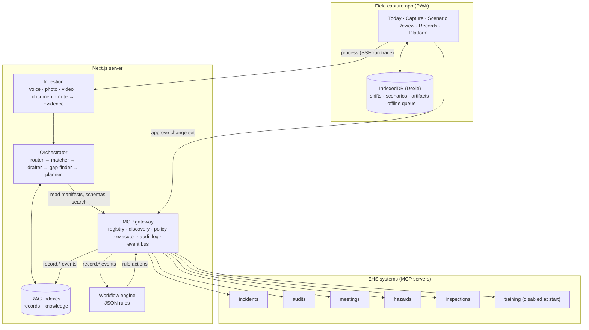
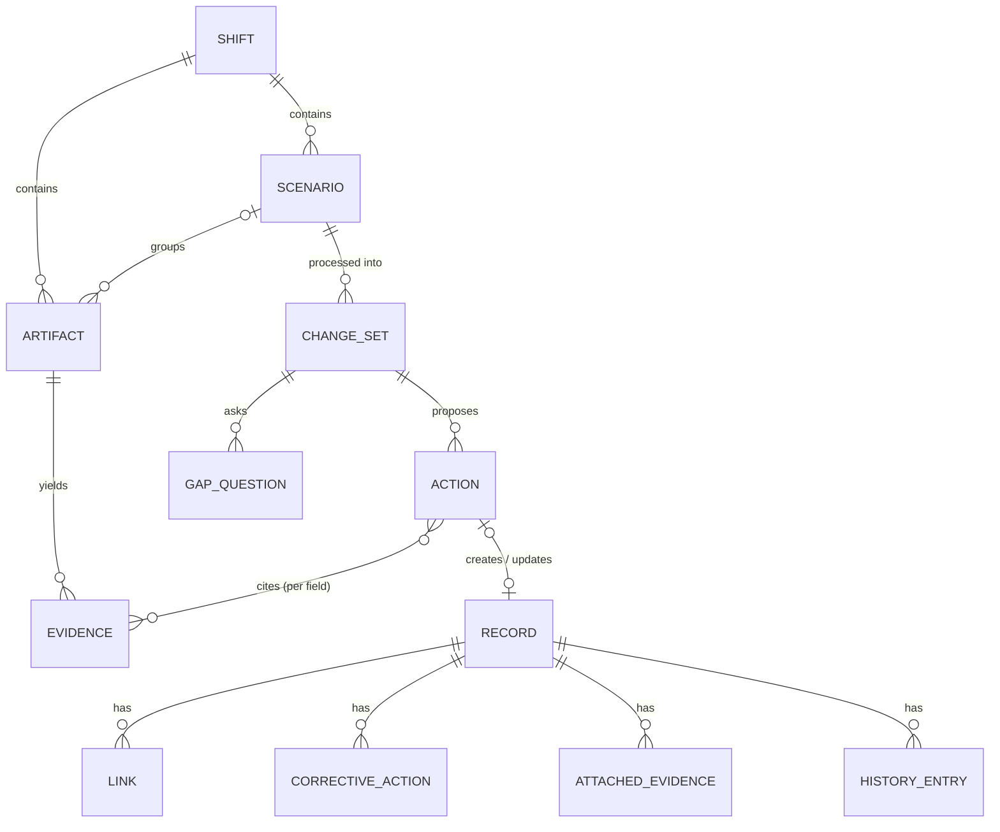
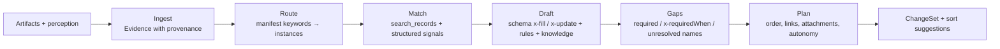
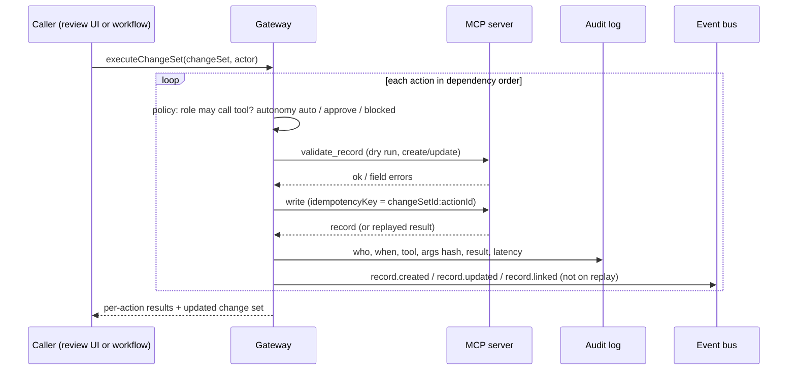
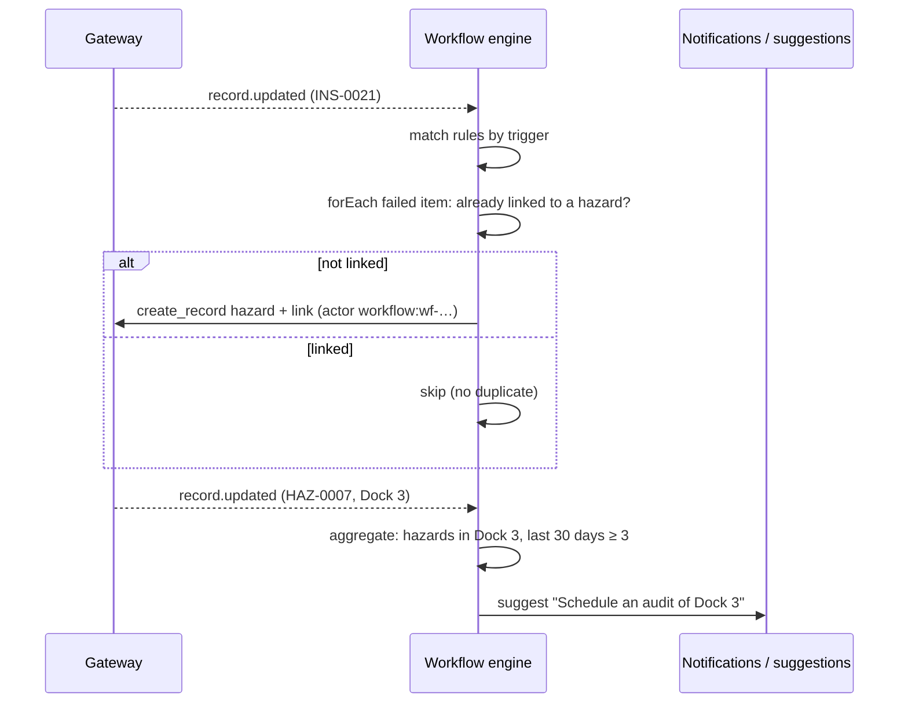
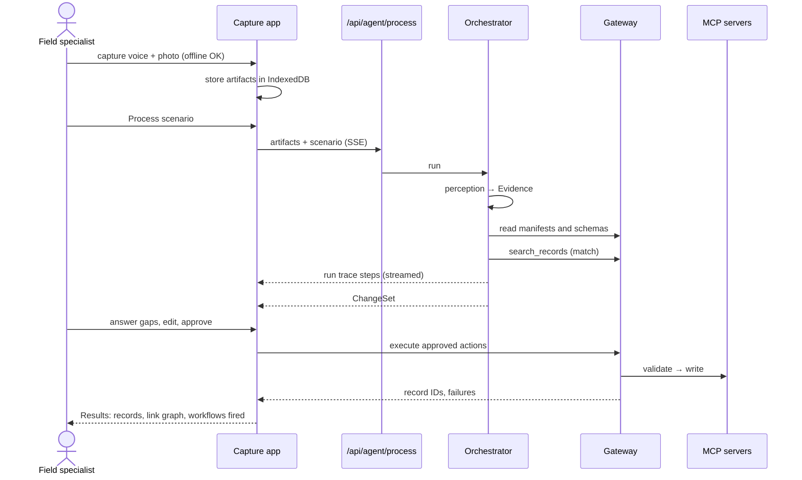

# Debrief — Architecture

## 1. Overview

All AI capabilities sit behind one `AgentProvider` interface (`src/agents/provider.ts`). The demo
provider uses fixture perception and real rule-based reasoning; a live model provider implements the
same interface.

## 2. Components

| Component                      | Location                                                 | Responsibility                                                                       |
| ------------------------------ | -------------------------------------------------------- | ------------------------------------------------------------------------------------ |
| Capture app                    | `src/app/(app)`, `src/capture`                           | Capture artifacts offline, group into scenarios, review and approve change sets      |
| Domain                         | `src/domain`                                             | Types and Zod schemas shared by every layer                                          |
| Ingestion                      | `src/agents/*` (perception methods)                      | Turn each artifact into `Evidence[]`                                                 |
| Orchestrator                   | `src/agents/orchestrator`                                | Route, match, draft, find gaps, plan a `ChangeSet`                                   |
| RAG                            | `src/rag`                                                | Hybrid search over records and knowledge                                             |
| Gateway                        | `src/mcp/gateway`                                        | The only path for writes: policy, validation, idempotency, audit, events             |
| Mock EHS servers               | `src/mcp/servers`                                        | One MCP server per module over a shared store                                        |
| Store                          | `src/mcp/store`                                          | Repository interface; `MemoryStore` seeded from `data/seed`, snapshotted to `.data/` |
| Workflow engine                | `src/workflows`                                          | Evaluate JSON rules on record events; act through the gateway                        |
| Console / Platform / Presenter | `src/app/console`, `src/app/platform`, `src/app/present` | Inspect the mock systems and the platform                                            |

**Boundary rule:** `src/agents/*` never imports from `src/mcp/servers/*`. The agent layer knows a
module only through what the gateway discovers at runtime.

## 3. Data model

### Capture side (client, IndexedDB)

- **Shift** — one user's work day (`date`, `siteId`, `startedAt`).
- **Scenario** — one situation; `status`: capturing → ready → processing → in_review → pushed.
- **Artifact** — one capture: `modality`, `capturedAt`, `capturedBy`, site/area, optional
  `assetTag`, `media` (blob key or demo asset path), optional `text` (note or edited transcript),
  quick-tag `tags`. `scenarioId: null` means it is in the Inbox.

### Evidence

An atomic fact from one artifact, with **provenance**:

| Provenance         | Points at                                                 |
| ------------------ | --------------------------------------------------------- |
| `transcript_span`  | Character range (and optional time range) in a transcript |
| `text_span`        | Character range in a note                                 |
| `image_region`     | Normalized bounding box; `frameMs` for video keyframes    |
| `document_field`   | Page, field name and excerpt                              |
| `capture_metadata` | Capture time, user, location, asset tag or tags           |

### Records (server side)

Every record shares an envelope (`src/domain/records/base.ts`): `id`, `server`, `recordType`,
`title`, `description`, `status`, `siteId`, `areaId`, `assetIds`, `createdAt/updatedAt/createdBy`,
`notes[]`, `correctiveActions[]`, `links[]`, `evidence[]`, `history[]`. Type-specific fields are
flat on the record so patch paths stay short (`severity`, `riskLevel`, `items[FE-115].response`).

| Record type         | Server      | ID     | Key fields                                                                                                            |
| ------------------- | ----------- | ------ | --------------------------------------------------------------------------------------------------------------------- |
| incident            | incidents   | `INC-` | incidentType, severity, occurredAt, involvedPeople, equipmentOperatorId, injury, recordable(+basis), immediateActions |
| hazard              | hazards     | `HAZ-` | category (taxonomy), riskLevel, identifiedAt, source                                                                  |
| observation         | hazards     | `OBS-` | observationType, category, severity, contractorId, stopWorkInvoked, spokeWithId                                       |
| audit               | audits      | `AUD-` | auditType, contractorId, scope, leadAuditorId, findings[] (each with correctiveActions[])                             |
| safety_meeting      | meetings    | `MTG-` | meetingType, topic, heldAt, durationMinutes, facilitatorId, attendees[], actionItems[]                                |
| inspection          | inspections | `INS-` | templateId, scheduledDate, completedAt, inspectorId, result, items[] (each with correctiveActions[])                  |
| training_assignment | training    | `TRN-` | course, assigneeIds, dueDate, reason                                                                                  |

Child items (inspection items, audit findings) are addressed by their `id`; for asset-based
inspections the item id is the asset tag. Links are stored on both records; a link from a child item
carries `itemId`.

### Change set

A `ChangeSet` holds ordered `ProposedAction`s — `create`, `update`, `link`, `attach` — each with
`confidence`, `rationale`, `autonomy` (`auto` / `approve` / `blocked`), `dependsOn`, and for creates
and updates a `fieldSupport` map: field path → `{ source, evidenceIds, citations, rule }`. Actions
that create records are referenced by later actions as `{ actionId }` until the gateway returns real
IDs. `GapQuestion`s target a field on an action; `SortSuggestion`s propose moving, merging or
splitting captures.

### Capture app (client)

| Part           | Location                                  | Role                                                                                                    |
| -------------- | ----------------------------------------- | ------------------------------------------------------------------------------------------------------- |
| Storage        | `src/capture/db.ts`                       | Dexie: shifts, scenarios, artifacts, blobs, perception (demo fixtures), settings, queue                 |
| Repository     | `src/capture/repo.ts`                     | Shift lifecycle, scenarios (create, rename, move, merge, split, delete), captures, Load demo day, clear |
| Pure logic     | `src/capture/scenarios.ts`, `demo-day.ts` | Merge/split planning, card summaries, demo-day rows from fixtures                                       |
| Browser media  | `src/capture/media.ts`, `speech.ts`       | Photo downscaling, durations, recorder format, Web Speech live transcript, read-aloud                   |
| Reference data | `src/capture/reference.ts`                | Areas, assets, people, hazard tags bundled for offline forms                                            |
| Screens        | `src/components/screens`                  | Today, Capture, Scenario (`/scenario?id=`), Inbox                                                       |
| Offline shell  | `public/sw.js`, `src/app/manifest.ts`     | Service worker and web app manifest                                                                     |

Every capture is written to IndexedDB the moment it exists (media blob first, details later in
the editor sheet), so nothing depends on a connection. The service worker caches the prerendered
app routes and their assets on install; see D-024.

## 4. Agent pipeline

| Stage  | Code                                                     | What it does                                                                                                                                                                                                                                                                                         |
| ------ | -------------------------------------------------------- | ---------------------------------------------------------------------------------------------------------------------------------------------------------------------------------------------------------------------------------------------------------------------------------------------------- |
| Ingest | `src/agents/demo/perception.ts`                          | Transcripts and notes → one statement per sentence (with character spans) and entity mentions; image findings with boxes (video findings with frame time); OCR text; document `Label: value` fields, pipe tables and numbered rows; capture metadata (time, user, site, area, asset tag, quick tags) |
| Route  | `orchestrator/router.ts`                                 | A record type is proposed when at least two distinct manifest keywords match non-negated evidence. Condition records get one instance per subject asset; events and scheduled records one per scenario                                                                                               |
| Match  | `orchestrator/matcher.ts`                                | Searches the instance's server for open records and scores asset, area, category, contractor, schedule and time-window signals; 0.6 or more updates. Also finds related open records to link                                                                                                         |
| Draft  | `orchestrator/drafter.ts`, `rules.ts`, `fill-helpers.ts` | Reads the module's JSON Schema from discovery and fills each field by its `x-fill` directive in dependency order; updates apply the manifest's mode (`patch` via `x-update`, `append_child`, `complete_checklist`). Every value carries evidence ids, a named rule, or a schema default              |
| Gaps   | `orchestrator/gaps.ts`                                   | Required and `x-requiredWhen` fields with no value become questions from `x-gapQuestion`; unmatched roster names become person questions                                                                                                                                                             |
| Plan   | `orchestrator/planner.ts`                                | Creates, updates, links (container → `foundDuring` with item id; otherwise event hub → `relatedTo`), attachments; autonomy from the gateway policy                                                                                                                                                   |
| Sort   | `orchestrator/suggestions.ts`                            | Inbox captures about a processed scenario's asset → move suggestion; scenarios sharing an asset → merge suggestion                                                                                                                                                                                   |

Language handling (`src/agents/nlp`): whole-word keyword matching with `*` wildcards and a
three-word negation and deferral window ("no cut", "hasn't been fixed", "until it is replaced");
a gazetteer over organization names and aliases plus asset-tag patterns (`FL-07`, `V22`); spoken
and written times ("eight forty", "1:00 PM"), durations and relative dates ("by Friday").

The pipeline (`orchestrator/pipeline.ts`) records every step and tool call in the run trace
(with an optional per-step delay for the animated view) and returns the change set, the evidence
and the titles of cited knowledge documents. `DemoProvider` implements `AgentProvider` with these
modules; `createLlmProvider()` is the stub for a model-backed provider.

### Schema metadata the orchestrator reads

| Keyword          | Meaning                                                                  |
| ---------------- | ------------------------------------------------------------------------ |
| `x-fill`         | How to fill the field on create (vocabulary in `src/domain/drafting.ts`) |
| `x-update`       | How new evidence changes the field on a matched record                   |
| `x-requiredWhen` | Conditions that make the field required                                  |
| `x-gapQuestion`  | Question template when it is required but unsupported                    |
| `x-picklist`     | Shared picklist used for labels                                          |

### Perception sources

Demo captures use their perception fixtures. The user's own captures are read on the device
before processing (`src/capture/device-perception.ts`): tesseract.js OCR for photos and paper
forms, pdf.js text for PDFs, four keyframes per video, and quick tags and captions as findings.
The server receives the perception output, not the media files.

## 5. MCP contract

Each module is an MCP server built with `@modelcontextprotocol/sdk` by one generic factory
(`src/mcp/servers/core/create-server.ts`) from a module definition (`src/mcp/servers/modules/*`):
manifest, initial statuses and picklists. Every server has the same tools and resources; only the
definition differs.

| Transport       | Used by                              | Notes                                                                     |
| --------------- | ------------------------------------ | ------------------------------------------------------------------------- |
| In-process      | The app's gateway (default)          | Linked in-memory transport; full MCP protocol, no network                 |
| Streamable HTTP | MCP Inspector, IDEs, remote gateways | `/api/mcp/[server]`, stateless, shares the app's store                    |
| stdio           | Claude Desktop, Inspector, IDEs      | `npm run --silent mcp -- <server>`; read-only snapshot unless `--persist` |

Each server's transport is configured in `mcp.config.json`.

### Tools

| Tool              | Arguments                                                                                                                                                    | Result                                  |
| ----------------- | ------------------------------------------------------------------------------------------------------------------------------------------------------------ | --------------------------------------- |
| `search_records`  | `query`, `recordType`, `siteId`, `areaId`, `assetId` (also matches child items), `status` (one or many), `from` / `to` (event time), `updatedSince`, `limit` | Ranked summaries with `score`           |
| `get_record`      | `id`                                                                                                                                                         | Full record                             |
| `create_record`   | `recordType`, `payload`, `idempotencyKey`, `actor`, `changeSetId`                                                                                            | `{ record, replayed }`                  |
| `update_record`   | `id`, `patch` (`set` / `append` / `remove`), `summary`, `idempotencyKey`, `actor`, `changeSetId`                                                             | `{ record, replayed, changes }`         |
| `attach_evidence` | `recordId`, `artifactId`, `modality`, `uri`, `caption`, `provenance`, `idempotencyKey`, `actor`                                                              | `{ record, replayed }`                  |
| `link_records`    | `recordId`, `targetId`, `linkType`, `itemId`, `targetItemId`, `idempotencyKey`, `actor`                                                                      | `{ record, replayed }` (this side only) |
| `validate_record` | `mode: create` + `recordType`, `payload`; or `mode: update` + `id`, `patch`                                                                                  | `{ valid, errors[], preview }`          |

Patch paths use dots and `[selector]` for list items, where the selector matches an item's `id`,
then its `name`, then an index: `items[FE-115].response`, `findings`, `attendees[T. Nguyen].personId`.
`id`, `server`, `recordType`, timestamps, `history`, `links` and `evidence` cannot be patched.

Writes are idempotent per server and key: a retry with the same arguments returns the first result
with `replayed: true`; the same key with different arguments is an error. Errors come back as
`isError` results with `{ error, fieldErrors[] }`.

On create and append the server fills child-item ids (`HAZ-0013-CA1`, `AUD-0004-F3`,
`MTG-0006-A1`), timestamps, default statuses and `dueInDays` → `dueDate`, then validates the whole
record against its schema and against organization data (sites, areas in the record's site, assets,
people, roles, contractors, hazard categories). Every write appends a history entry with
before/after values for each changed path.

### Resources

- `ehs://{server}/manifest` — record types with display name, id prefix, **routing hints**
  (keywords, example situations, "use when", taxonomy categories), **matching hints** (strategy
  `condition` / `event` / `scheduled`, open statuses, signal fields, time window), child
  collections, and allowed link types.
- `ehs://{server}/schema/{recordType}` — the **create-payload** JSON Schema: no server-managed
  fields, `status` defaulted, child items in input form, `x-*` extraction metadata on fields.
- `ehs://{server}/picklists` — severity, risk level, hazard categories, statuses per record type,
  and module enumerations.

## 6. Gateway

| Part        | File                                     | Role                                                                                                                                   |
| ----------- | ---------------------------------------- | -------------------------------------------------------------------------------------------------------------------------------------- |
| Registry    | `gateway/registry.ts`                    | Servers from `mcp.config.json`; enable/disable at runtime                                                                              |
| Connections | `gateway/connections.ts`                 | One MCP client per server over its configured transport                                                                                |
| Discovery   | `gateway/discovery.ts`                   | Tools (namespaced `incidents.create_record`), manifests, schemas, picklists of enabled servers; cache dropped when a server is toggled |
| Policy      | `gateway/policy.ts` + `data/policy.json` | Role → tool patterns; ordered autonomy rules by action, server, record type, existing/new target                                       |
| Audit log   | `gateway/audit-log.ts`                   | Every call, including refusals and validation                                                                                          |
| Event bus   | `gateway/event-bus.ts`                   | Awaited handlers; workflow writes finish before the triggering call returns                                                            |
| Gateway     | `gateway/gateway.ts`                     | `call()`, record helpers, `link()`, `executeChangeSet()`                                                                               |

- **Record routing.** `serverFor(id)` maps an id prefix to a server using the enabled servers'
  manifests, so no prefix table is hard-coded in the gateway.
- **Links.** `link()` checks the target exists, then writes the forward link on the source's
  server and the inverse link on the target's server (`relatedTo`↔`relatedTo`,
  `causedBy`↔`resultedIn`, `foundDuring`→`resultedIn`), with item ids carried across.
- **Change sets.** Actions run in topological order of `dependsOn` plus `{ actionId }`
  references, which are resolved to the created record ids. Approve-level actions run only when
  approved; actions waiting on approval are skipped with their dependents; dependents of a failed
  action fail; independent actions continue. The change set comes back with action statuses and
  `resultRecordId`s, and running it again retries only what did not execute.

The EHS console reads the store directly (it is the mock systems' own UI) and subscribes to the
store's change feed over SSE, so it also reflects writes from external MCP clients.

## 7. RAG

Both indexes are MiniSearch (BM25 with prefix and fuzzy matching) plus metadata filters, behind
an `Embedder` interface (`src/rag/embedder.ts`) so vector similarity can be blended in later.

- **Records index** (`src/rag/records-index.ts`) — every record on the enabled servers, read page
  by page through `search_records` (the agent never reads a store) and rebuilt lazily after any
  `record.*` event or server toggle. Used to find related open records. Candidate search for find
  and update uses each server's own `search_records`.
- **Knowledge index** (`src/rag/knowledge-index.ts`) — SOPs and regulation summaries chunked by
  `##` section, structured corrective-action guidance lines, the hazard taxonomy and checklist
  templates. Provides citations for categories, recordability and requirement references, and
  the guidance behind drafted corrective actions.

## 8. Workflows

Rules are JSON files in `data/workflows/`, validated by `WorkflowRule` (`src/domain/workflow.ts`):

- `trigger` — event(s), optional server and record type.
- `conditions` — field conditions on the triggering record.
- `aggregate` — optional count over recent records grouped by a field within a window.
- `forEach` — optional per-child-item evaluation with `where` filters and `unlessLinked`.
- `actions` — `notify`, `create_record`, `update_record`, `link_records`, `suggest`.

Rule actions go through the gateway like agent actions, so they are permissioned and audited.

## 9. End-to-end sequence

## 10. Adding a module

1. Implement a server factory with the uniform tools and resources.
2. Publish a manifest with routing hints and a schema per record type.
3. Register it in `mcp.config.json` (or enable it on the Platform screen).

The router, matcher and drafter pick it up from discovery on the next run.

## 11. Data and fixtures layout

| Path                                    | Contents                                                 | Validated by        |
| --------------------------------------- | -------------------------------------------------------- | ------------------- |
| `data/seed/org.json`                    | Sites, areas, assets, roles, people, contractors         | `Organization`      |
| `data/seed/records/<server>.json`       | Seed records per server                                  | `EhsRecord[]`       |
| `data/knowledge/sops/*.md`, `osha/*.md` | Knowledge docs with frontmatter                          | `KnowledgeDocMeta`  |
| `data/knowledge/hazard-taxonomy.json`   | Hazard categories and keywords                           | `HazardTaxonomy`    |
| `data/knowledge/checklists/*.json`      | Inspection templates                                     | `ChecklistTemplate` |
| `data/workflows/*.json`                 | Workflow rules                                           | `WorkflowRule`      |
| `fixtures/scenarios/S*.json`            | Demo artifacts, perception fixtures, paraphrase variants | `ScenarioFixture`   |
| `fixtures/expected/S*.json`             | Expected change sets for evals                           | `ExpectedChangeSet` |

`tests/data.test.ts` validates every file and checks cross-references (people, areas, assets,
record IDs, artifact IDs, knowledge doc IDs, rule IDs) and the preconditions the scenarios rely on.

Perception fixtures hold what a speech, vision or document model would return (transcripts,
findings with bounding boxes, extracted text), not `Evidence`; converting them to evidence is part
of the real pipeline. Document fixture text is also the source for generating the demo PDFs.
